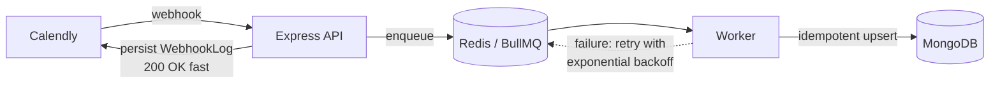
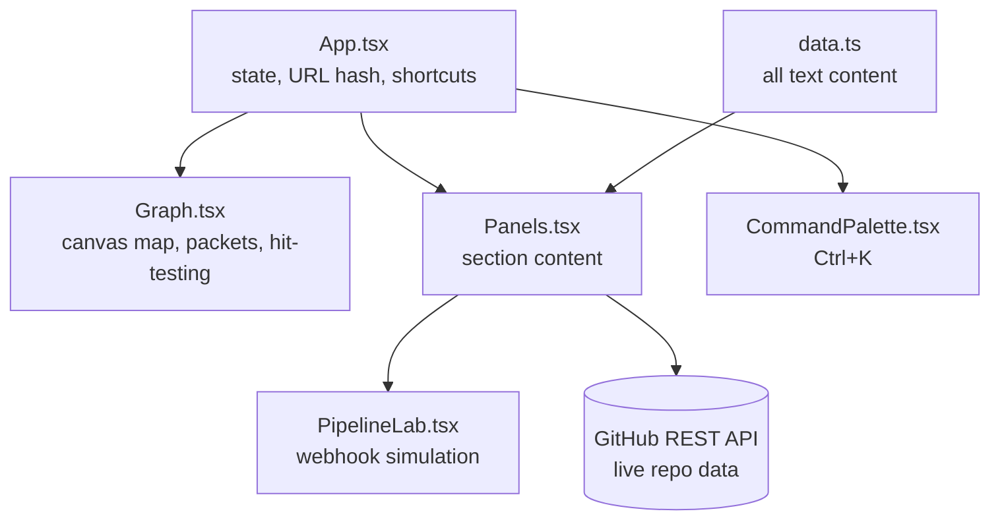

<div align="center">

# Divyansh Sharma · Interactive Portfolio

**Backend & Integration Engineer**: OAuth flows, webhooks, queues and data sync.

This portfolio is not a scrolling page. It is a live map of the systems I connect.


[GitHub](https://github.com/divyanshsharma11) · [LinkedIn](https://www.linkedin.com/in/divyansh-sharma1121/) · [Email](mailto:divyanshsharma1121@gmail.com)

</div>

---

## What you can do on the site

| Interaction | What happens |
| --- | --- |
| **Hover an outer node** | Shows what I built with that integration (Calendly, HubSpot, Stripe, Gmail, Pub/Sub, Redis, MongoDB and more). |
| **Click a section node** | Opens About, Experience, Projects, Pipeline Lab or Contact in a side panel. The map stays alive behind it. |
| **Move your mouse** | The graph shifts in layered parallax while data packets flow from integrations to the centre. |
| **Press `Ctrl` + `K`** | Opens a command palette to jump between sections, open links or copy my email. |
| **Fire a webhook in the Pipeline Lab** | Watch an event move through API → Queue → Worker → MongoDB. |
| **Share a link like `/#projects`** | Opens the site straight on that section. |

<details>
<summary><b>Try this in the Pipeline Lab</b> (click to expand)</summary>

<br>

1. Click **Fire webhook** and watch the event go through every stage to `done`.
2. Click **Send duplicate**. The idempotent upsert catches it, and it ends as `deduped`.
3. Turn on **Simulate MongoDB outage** and fire again. The worker retries with exponential backoff (600 ms → 1.2 s → 2.4 s) and, after 4 attempts, the job fails.
4. Turn the outage off mid-retry. The next attempt succeeds.

> **Note:** the lab is a simulation that runs entirely in the browser. It models the architecture of my [Calendly integration service](https://github.com/divyanshsharma11/calendlyIntegration). No real servers are called, and the timings are illustrative.

</details>

---

## The architecture the Pipeline Lab models



Acknowledging fast and processing in a separate worker keeps the webhook endpoint quick. Retries and idempotent writes make the pipeline safe against outages and duplicate deliveries.

---

## How the site is built



<details>
<summary><b>Project structure</b></summary>

```text
src/
├── App.tsx                  # layout, active section, URL hash, keyboard shortcuts
├── data.ts                  # all portfolio content: edit this to update the site
├── index.css                # design tokens and styles
├── main.tsx                 # entry point
└── components/
    ├── Graph.tsx            # canvas-rendered integration map
    ├── Panels.tsx           # About, Experience, Projects, Contact panels + live GitHub card
    ├── PipelineLab.tsx      # interactive webhook pipeline simulation
    └── CommandPalette.tsx   # Ctrl+K command palette
```

</details>

<details>
<summary><b>Technical notes</b></summary>

<br>

- **Rendering:** the map is drawn on a single `<canvas>` with `requestAnimationFrame`, scaled for high-DPI screens and resized with a `ResizeObserver`.
- **Motion:** nodes ease toward their orbit positions, so the layout stays smooth on resize and when a panel opens. Ambient packets are turned off when the OS asks for reduced motion.
- **Live data:** the Projects panel fetches public repo stats from the GitHub API and hides itself if the request fails or is rate-limited.
- **Accessibility:** keyboard shortcuts, `Esc` to close, labelled dialogs, visible focus rings, and an `aria-live` log in the Pipeline Lab.
- **No backend:** everything is static and can be hosted on any static host.

</details>

---

## Run it locally

Requires **Node.js 18+**.

```bash
git clone https://github.com/divyanshsharma11/Portfolio.git
cd Portfolio
npm install
npm run dev        # http://localhost:5173
```

| Command | Purpose |
| --- | --- |
| `npm run dev` | Start the dev server with hot reload |
| `npm run build` | Type-check and build to `dist/` |
| `npm run preview` | Serve the production build locally |
| `npm run lint` | Run ESLint |

## Update the content

All text lives in [`src/data.ts`](src/data.ts): profile, stats, experience, projects and skills. Edit it and the site updates. No component changes are needed.

## Deploy

The build output in `dist/` is static. It works on **Vercel**, **Netlify**, **Cloudflare Pages** or **GitHub Pages** with build command `npm run build` and output directory `dist`.

---

<div align="center">

**Open to backend and integration engineering roles, in Bengaluru or remote.**

[Get in touch](mailto:divyanshsharma1121@gmail.com)

</div>
