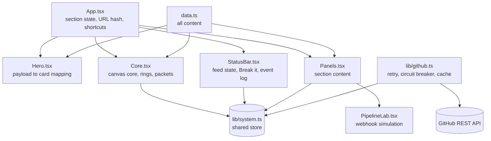

<div align="center">

# Divyansh Sharma · Interactive Portfolio

**Backend & Integration Engineer**: OAuth flows, webhooks, queues and data sync.

This portfolio is not a scrolling page. It is a small integration layer you can poke at: raw data on one side, a readable profile on the other, and a live core in the middle.


[GitHub](https://github.com/divyanshsharma11) · [LinkedIn](https://www.linkedin.com/in/divyansh-sharma1121/) · [Email](mailto:divyanshsharma1121@gmail.com)

</div>

---

## What you can do on the site

| Interaction                           | What happens                                                                                                                                                                                                                                                                              |
| ------------------------------------- | ----------------------------------------------------------------------------------------------------------------------------------------------------------------------------------------------------------------------------------------------------------------------------------------- |
| **Read the card**                     | Name, role, experience, integrations, credential and availability are visible in the first screen.                                                                                                                                                                                        |
| **Drag a field onto the card**        | The left side is a raw `profile.json`. Drag a field onto a slot (or click a field, then a slot) to remap it. Types are validated: dropping a number on a name slot is rejected with a `TypeError`.                                                                                        |
| **Spin the core**                     | Drag anywhere around the core to rotate both rings; release with a flick and it keeps its momentum.                                                                                                                                                                                       |
| **Click a connector**                 | Hover an outer connector to see what I built with it. Click it to jump to the matching card: M32.ai integrations open the M32.ai role, Vodex.AI ones the Vodex.AI role, and each project has its own connector. Gmail belongs to both roles, so clicking it again jumps to the other one. |
| **Click a segment**                   | Opens About, Experience, Projects, Pipeline Lab or Contact in a side panel.                                                                                                                                                                                                               |
| **Flip "Break it" in the status bar** | Cuts the site's live GitHub connection on purpose. Watch retries, the circuit breaker opening, the fallback to cached data and the automatic recovery in the event log.                                                                                                                   |
| **Press `Ctrl` + `K`**                | Command palette: jump to a section, toggle Break it, open links, download the résumé.                                                                                                                                                                                                     |
| **Share a link like `/#projects`**    | Opens straight on that section.                                                                                                                                                                                                                                                           |

Everything the core's readouts show (GitHub state, breaker state, packet flux) is the site's real state.

<details>
<summary><b>What "Break it" really does</b> (click to expand)</summary>

<br>

The GitHub card and the core read live data through [`src/lib/github.ts`](src/lib/github.ts):

1. Every request is retried twice with backoff (500 ms, then 1 s).
2. Three consecutive failures **open the circuit breaker** and pause calls for 8 s.
3. While degraded, the site serves the last good response from `localStorage`, labelled **cached**, or an **offline** state if there is nothing cached.
4. After the cooldown the breaker goes **half-open**, sends one trial request and, if it succeeds, **closes** again.

"Break it" injects the failure just before the request goes out. Everything after that is the real recovery path, and it is covered by unit tests.

</details>

<details>
<summary><b>The Pipeline Lab</b> (click to expand)</summary>

<br>

A simulation of the webhook architecture behind my [Calendly integration service](https://github.com/divyanshsharma11/calendlyIntegration): acknowledge fast, process in a separate worker, retry with exponential backoff, upsert idempotently.

1. **Fire webhook**: an event moves through API → Queue → Worker → MongoDB.
2. **Send duplicate**: the idempotent upsert catches it (`deduped`).
3. **Simulate MongoDB outage**: the worker retries with backoff (600 ms, 1.2 s, 2.4 s) and fails the job after 4 attempts.

> It runs entirely in the browser and is labelled as a simulation in the UI. No real servers are called and the timings are illustrative.

</details>

---

## Architecture



<details>
<summary><b>Project structure</b></summary>

```text
src/
├── App.tsx                  # layout, active section, URL hash, shortcuts, command list
├── data.ts                  # all portfolio content: edit this to update the site
├── sections.ts              # section ids, titles and colours
├── index.css                # design tokens and styles
├── main.tsx                 # entry point, error boundary, self-hosted fonts
├── lib/
│   ├── system.ts            # shared store: breaker/feed state, event log
│   ├── github.ts            # GitHub client: retry, circuit breaker, cache, validation
│   ├── github.test.ts       # unit tests for the above
│   └── resume.ts            # shows résumé buttons only if the PDF exists
└── components/
    ├── Core.tsx             # canvas-rendered integration core
    ├── Hero.tsx             # raw payload to readable card mapping
    ├── Panels.tsx           # About, Experience, Projects, Contact panels
    ├── PipelineLab.tsx      # webhook pipeline simulation
    ├── StatusBar.tsx        # live status, Break it switch, event log
    ├── CommandPalette.tsx   # Ctrl+K palette
    └── ErrorBoundary.tsx    # readable fallback if rendering fails
```

</details>

---

## Run it locally

Requires **Node.js 20+** (the test runner, Vitest 4, does not support Node 18).

```bash
git clone https://github.com/divyanshsharma11/Portfolio.git
cd Portfolio
npm install
npm run dev        # http://localhost:5173
```

| Command           | Purpose                                         |
| ----------------- | ----------------------------------------------- |
| `npm run dev`     | Dev server with hot reload                      |
| `npm run build`   | Type-check and build to `dist/`                 |
| `npm run preview` | Serve the production build locally              |
| `npm test`        | Run the unit tests                              |
| `npm run lint`    | ESLint                                          |
| `npm run format`  | Format with Prettier (`format:check` to verify) |

CI (`.github/workflows/ci.yml`) runs formatting, lint, tests, the build and a production-dependency audit on every push and pull request.

## Update the content

All text lives in [`src/data.ts`](src/data.ts): profile, stats, experience, projects, skills and the integrations shown on the core. The résumé is served from `public/Divyansh-Sharma-Resume.pdf`; the buttons appear only when that file exists.

## Security and privacy

- No backend, no secrets, no cookies, no analytics. The event log stays in memory in your browser.
- The only network call is to the public GitHub API. Responses and cached data are validated (shape and `https://github.com/` links) before they are rendered.
- Fonts are self-hosted, so visitors' IPs are not sent to a font CDN.
- Production builds ship a strict Content-Security-Policy (`default-src 'self'`, `connect-src` limited to `api.github.com`). Hosts that support response headers should also send it as a header, plus `X-Content-Type-Options: nosniff`, `Referrer-Policy: strict-origin-when-cross-origin` and `X-Frame-Options: DENY`.
- External links use `rel="noreferrer"` / `noopener`.

## Deploy

The build output in `dist/` is static. It works on **Vercel**, **Netlify**, **Cloudflare Pages** or **GitHub Pages** with build command `npm run build` and output directory `dist`.

---

<div align="center">

**Open to backend and integration engineering roles, in Bengaluru or remote.**

[Get in touch](mailto:divyanshsharma1121@gmail.com)

</div>
